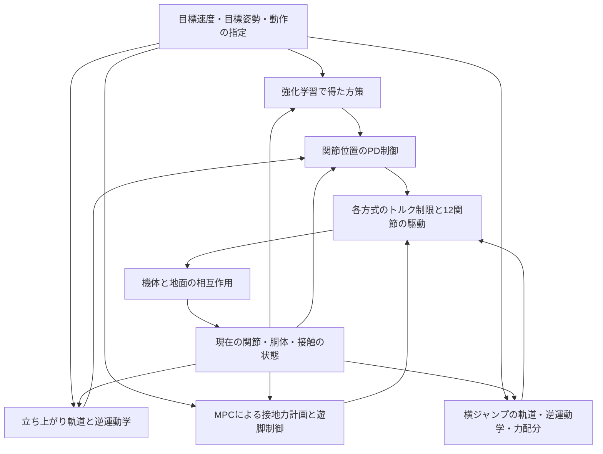

# Pochi の構成解説 — メカ・電装・制御

Pochi は、CoRE ストライダー部門向けに開発されている四脚ロボットです。各脚に3つの駆動関節を持ち、合計12基の RobStride RS02 で足先を動かします。胴体を支える脚の力と、踏み出す脚の動きを組み合わせて、立ち上がりや歩行を行います。

この文書は、2026年9月27日時点の作業ツリーにある CAD データ、シミュレーションモデル、制御コードをもとにしています。**寸法の設計値、シミュレーションの設定値、実機で確認された情報を区別して記載します。** 特に電装の詳細は資料が少なく、搭載機器や配線が確定できない部分があります。

## 1. 全体像

| 分野 | 構成 | このリポジトリで確認できる範囲 |
| --- | --- | --- |
| メカ | 胴体フレーム、4本の脚、12関節、足裏パッド | Onshape 由来の URDF・メッシュ、MuJoCo モデル |
| 駆動 | 全関節に RS02 を使用 | 配置、モデルで使う質量・トルク・速度の値 |
| 電装 | モーターへの指令・フィードバック、電源、計算機、センサー | モーターと制御側が扱う情報は確認可能。実配線・機器型番は一部未確認 |
| 制御 | 逆運動学による立ち上がり、強化学習、MPC 歩行、横ジャンプ | 主に `pochi_rl/` 内のシミュレーション実装 |
| 上位システム | ROS 2 の起動手順、FAST-LIO、ボディコントローラー | トップレベル README に記載あり。該当パッケージ本体はこのリポジトリに含まれない |

基本的な処理は、「目標の動きを決める → 関節の目標角度やトルクを計算する → モーターで脚を動かす → 現在の状態を読み取る」という繰り返しです。現在の実装では、動作ごとに異なる制御方式を使います。

## 2. メカ：どのような骨格で、どこが動くか

### 2.1 脚の配置と座標系

ロボットの前を `+X`、左を `+Y`、上を `+Z` とします。胴体座標の原点は、4か所の股関節中心の中央です。

```text
                    前方（+X）

       左前脚 FL                 右前脚 FR
            ○────── 胴体 ──────○
            │                  │
            ○──────────────────○
       左後脚 RL                 右後脚 RR

       左（+Y）                 右（−Y）
                 ※ 上から見た配置
```

`FL` は Front Left、`FR` は Front Right、`RL` は Rear Left、`RR` は Rear Right の略です。4本の脚は同じ基本寸法を持ちます。

### 2.2 1本の脚は3自由度

各脚は、胴体から足先へ向かって次のようにつながっています。

```text
胴体
 └─ 股関節ロール：脚を左右に開閉する
     └─ 股関節ピッチ：脚を前後に振る
         └─ 上腿リンク（200 mm）
             └─ 膝関節：脚を曲げ伸ばしする
                 └─ 下腿リンク（225 mm、膝軸から足先まで）
                     └─ 足裏パッド
```

| 関節名 | 基準姿勢での回転軸 | 役割 | 駆動数 |
| --- | --- | --- | ---: |
| `hip_roll` | 前後方向の X 軸 | 脚を左右に開閉し、足先の左右位置を変える | 4 |
| `hip_pitch` | 左右方向の Y 軸 | 上腿を前後に振り、足先の前後位置を変える | 4 |
| `knee` | 左右方向の Y 軸 | 脚の長さを変え、胴体高さや足先の持ち上げ量を調整する | 4 |

股関節のロール軸とピッチ軸は交差し、モデル上では同じ位置を原点にしています。足先の位置は3関節の組み合わせで決まり、例えば高さを変える際も股関節ピッチと膝を協調させます。

RS02 の配置は、胴体にロール用が4基、各脚の股関節側にピッチ用が1基、上腿側に膝用が1基です。下腿と足先は、その膝関節から先につながります。

### 2.3 フレームと部材

CAD の部品名と変換コードから、胴体の角パイプ、カーボン板、アルミスペーサー、樹脂部品、ねじを組み合わせた構成が読み取れます。

| 部位・部材 | CAD に現れる例 | 読み取れる内容 |
| --- | --- | --- |
| 胴体の骨格 | `Body_pipe...` | アルミ角パイプとして扱われる部品。名称には 25×15、15×15、肉厚1.5 mmなどの寸法が含まれる |
| 胴体の板材 | `carbon_Body_plate...` | 名称上は板厚2 mm、3 mmのカーボン板 |
| 股関節・脚の板材 | `carbon_plate_hip...`、`carbon_plate_calf...`、`carbon_plate_knee...` | 主に3 mm、膝周辺には4 mmのカーボン板 |
| 間隔を保つ部材 | `plate_hip_3_2_spacerAl5mm...` | 厚さ5 mmのアルミスペーサー |
| 樹脂部品・足裏 | `Part_1...`、各脚の足裏メッシュ | モデル資料では大型の `Part 1` を造形樹脂として扱い、足裏も造形部品として説明している |
| 締結部品 | `M3_...`、`M4_...` | M3・M4ねじ |

これは部品データからの説明であり、実物の材質証明や完成版の部品表ではありません。特に汎用名の `Part_1...` には複数の部品が含まれ、すべてを同じ材質とは扱えません。

### 2.4 主要寸法と質量

| 項目 | 値 | 値の意味 |
| --- | ---: | --- |
| 胴体中心から股関節までの前後距離 | ±254.5 mm | 前後の股関節中心間は509 mm |
| 胴体中心から股関節までの左右距離 | ±70 mm | 左右の股関節中心間は140 mm |
| 上腿長 | 200 mm | 股関節ピッチ軸から膝軸まで |
| 下腿長 | 約225 mm | 膝軸から足先まで |
| 足先の外側へのオフセット | 約98 mm | 脚の前後運動面から、左右それぞれ外側へずれる量 |
| 足裏パッド | 幅16 mm、前後方向の曲面半径は約19 mm | モデル資料に記載された CAD 形状 |
| 標準姿勢の胴体原点高さ | 約317 mm | 地面から股関節中心高さまで。機体の全高ではない |
| CAD 由来の機体質量 | 約7.92 kg | RS02 を1基0.405 kgとして補正したモデル値 |
| 仮の搭載重量 | 3.00 kg | バッテリー・電装などを代表する追加質量 |
| シミュレーションの総質量 | 約10.92 kg | 上記を合計した値。完成実機の実測重量ではない |

股関節中心間の距離は、機体外形や足先の接地幅とは異なります。足先はさらに外側にオフセットしており、脚の角度によって接地位置が変わります。

仮の搭載重量は、胴体中央に置いた3 kgの鋼製ブロック相当として慣性も計算しています。これは実機にそのブロックが付いているという意味ではなく、未確定の搭載物をモデルで代表させたものです。

### 2.5 標準姿勢と関節の可動範囲

関節角度がすべて0のときは、脚が下向きに伸びた基準姿勢です。標準の立ち姿勢では、前脚と後脚を前後対称に曲げます。

| 脚 | `hip_roll` | `hip_pitch` | `knee` |
| --- | ---: | ---: | ---: |
| 前脚 FL・FR | 0 rad | +0.8 rad | −1.5 rad |
| 後脚 RL・RR | 0 rad | −0.8 rad | +1.5 rad |

この配置は資料で「M型」と呼ばれ、重心が胴体中央付近に来るようにしています。

現在のモデルに設定された範囲は、ロールが±0.7 rad、ピッチが±1.6 rad、膝が±2.4 radです。**これらは暫定的なソフトウェア上の範囲であり、実機のストッパー位置を測定した値ではありません。**

出典：[機体モデルの説明](pochi_rl/assets/pochi/README.md)、[寸法・関節定数](pochi_rl/src/pochi_rl/robot/pochi_constants.py)、[CAD 部品](pochi_rl/pkg_4leg_assem2/meshes/)、[CAD 変換処理](pochi_rl/src/pochi_rl/cad/convert.py)。

## 3. 電装：何が駆動し、何を読み取るか

### 3.1 アクチュエーター

全12関節を RS02 で駆動する構成です。減速機を含む関節アクチュエーターとしてモデル化されており、制御コードは各関節の角度・角速度を扱います。

以下は、リポジトリが RS02 の仕様として採用している値です。実機の測定結果や最新のメーカー仕様をこの文書で検証したものではありません。

| 項目 | モデルで採用している値 |
| --- | ---: |
| 個数 | 12基 |
| 1基の質量 | 0.405 kg |
| 減速比 | 7.75 : 1 |
| ピークトルク | 17 N·m |
| 連続定格トルク | 7 N·m、100 rpm時 |
| 無負荷回転速度 | 約42.9 rad/s、約410 rpm |

ピークトルクは低速域での値です。歩行用の学習環境や MPC・横ジャンプでは、回転が速くなるほど出せるトルクが小さくなる特性をモデルに入れています。

低速歩行の資料とコードには、実機の RS02 の MIT モードに対応する値として `Kp = 140 N·m/rad`、`Kd = 1.5 N·m·s/rad` が記載されています。ここで `Kp` は角度のずれに対する戻す力の強さ、`Kd` は動きを減衰させる強さです。ゲインは制御方式によって異なり、全プログラムがこの値を使うわけではありません。

### 3.2 制御が必要とする情報

| 情報 | 主な用途 | このリポジトリでの扱い |
| --- | --- | --- |
| 12関節の角度 | 姿勢の把握、足先位置の計算、位置制御 | シミュレーターから取得。解析的立ち上がりは関節エンコーダー相当の入力だけで動く設計 |
| 12関節の角速度 | 減衰制御、学習方策の入力、トルク制限 | シミュレーターから取得 |
| 胴体姿勢・角速度 | 傾きの把握、姿勢維持 | モデルに姿勢・ジャイロ等の仮想センサー定義があり、各制御はモデル状態も参照する |
| 胴体・重心の位置と並進速度 | 速度追従、MPC、ジャンプの着地制御 | シミュレーターの状態から取得。実機用の推定処理はこの実装に含まれない |
| 足の接触・接地力 | 学習時の評価、離地・着地の判定など | 仮想接触センサーや MuJoCo の接触計算を利用 |

MuJoCo モデルには、胴体の姿勢、角速度、加速度、速度と、4足の接触を扱うセンサー定義があります。ただし、**モデルに `imu` や `touch` があることは、同じ機器が実機に搭載されている証拠にはなりません。** また、学習環境は胴体速度などをモデル状態から直接取得しています。

実機で同じ制御入力を用意するには、関節情報に加えて姿勢・速度・接触などを計測または推定する仕組みが必要です。トップレベル README には FAST-LIO を使う実機モードが記載されていますが、センサー型番や、その出力と `pochi_rl` をつなぐ実装は確認できません。

### 3.3 電装で未確認の部分

現状のファイルだけでは、実機の電装を配線図の精度で説明することはできません。確認できない項目は次のとおりです。

| 項目 | 資料上の状態 |
| --- | --- |
| バッテリーの種類・電圧・容量 | 未確認。モデルでは電装全体を3 kgの仮の搭載重量に含める |
| 電源分配、DC-DC、ヒューズ、主電源・非常停止回路 | 回路図・配線表が見当たらない |
| 搭載PC、マイコン、モーター通信アダプター | 型番と役割分担を確認できない |
| モーターとの通信 | 通信方式、バスの分割、ID、通信周期を確認できない |
| IMU・LiDARなど | 実機の型番、取付位置、接続先を確認できない |
| 足裏の実センサー | 搭載の有無を確認できない |

出典：[RS02 の定数](pochi_rl/src/pochi_rl/robot/pochi_constants.py)、[モデルのセンサー定義](pochi_rl/assets/pochi/pochi.xml)、[低速歩行の設定](pochi_rl/src/pochi_rl/mjlab/deliberate_walk.py)、[実機起動手順の記載](README.md)。

## 4. 制御：目標の動きを12関節へ変換する

### 4.1 制御方式の分担

このリポジトリには、同じ機体モデルを使う複数の制御方式があります。以下はその関係を表す図で、実機の配線図ではありません。



図の各方式は、用途に応じて選ぶ独立した実装です。複数の方式が同時に同じ関節へ指令を出す構成ではありません。

| 方式 | 動作の決め方 | 関節への出力 | 学習済みモデル |
| --- | --- | --- | --- |
| 解析的な立ち上がり | 時間に沿った姿勢変化と逆運動学 | 12関節の目標角度 | 不要 |
| 強化学習による歩行・立ち上がり | 観測をニューラルネットワークに入力 | 目標角度を作る12要素の行動 | 必要 |
| MPC 歩行 | 未来の重心運動と接地力を計画 | 12関節のトルク | 不要 |
| 横ジャンプ | 動作段階の切替、3次元逆運動学、支持脚への力配分 | PD成分と支持力成分を合わせたトルク | 不要 |

### 4.2 関節を動かす基本：PD制御

歩行の学習方策と解析的立ち上がりは、まず関節の目標角度を作ります。位置制御の基本は次の形です。

```text
関節トルク = Kp ×（目標角度 − 現在角度）
           + Kd ×（目標角速度 − 現在角速度）
```

位置目標だけを与える経路では、目標角速度は基本的に0として扱います。角度の誤差を戻す力と、動きを減衰させる力を足し合わせ、その後に出力制限を適用します。

MuJoCo 単体のモデルは `Kp = 60`、`Kd = 1.5`、出力範囲±17 N·mの位置アクチュエーターを持ちます。`mjlab` の学習環境では、これを関節位置からトルクを計算するモーターモデルに置き換え、速度に応じたトルク制限も適用します。低速歩行の学習環境は `Kp = 140`、`Kd = 1.5` を使います。

このため、同じ目標角度を与えても、どの実行経路・ゲイン・制限値を使うかで動きは変わります。

### 4.3 逆運動学による立ち上がり

逆運動学（IK）は「足先をこの位置に置くには、各関節を何度にすればよいか」を求める計算です。立ち上がりでは、主に股関節ピッチと膝を2本のリンクとして扱います。

立ち上がりの標準シーケンスは次のとおりです。

1. **待機：0.75秒。** 開始時の関節角度を保持します。
2. **支持姿勢へ移行：2.5秒。** 左右に開いた股関節を戻し、四足で支える低い姿勢へ移ります。
3. **起立：5秒。** 胴体高さの目標を滑らかに増やし、IKで関節角度へ変換します。
4. **保持。** 標準の高さで立ち続けます。

待機から起立までの標準所要時間は8.25秒です。始めと終わりの速度が急変しない軌道を使い、関節角度から計算した脚の伸びをフィードバックして、自重で沈む分も補正します。

このコントローラーの入力は関節角度だけです。実機へ移す際の入出力を簡潔にできる構成ですが、ここで確認できる動作と評価はシミュレーション上のものです。

実装：[立ち上がり](pochi_rl/src/pochi_rl/control/standup.py)、[脚の順運動学・逆運動学](pochi_rl/src/pochi_rl/control/leg_kinematics.py)、[MuJoCo 実行部](pochi_rl/src/pochi_rl/control/mujoco_driver.py)。

### 4.4 強化学習による制御

強化学習では、シミュレーター内の試行から「現在の状態に対して、どの関節目標を出すと目的の動きになるか」を学習します。物理計算に MuJoCo、学習環境に mjlab、学習アルゴリズムに RSL-RL の PPO を使います。

| タスク | 目的 | 方策への入力数 |
| --- | --- | ---: |
| `Pochi-Velocity-Flat-v0` | 平地で指定した前後・左右・旋回速度へ追従する | 48 |
| `Pochi-Deliberate-Walk-v0` | 一脚ずつ踏み出す低速歩行と停止を学習する | 50 |
| `Pochi-StandUp-Flat-v0` | 寝た姿勢から、時間に沿った高さ・関節軌道を追従して起立する | 47 |

通常の速度追従タスクの48入力は、胴体の並進速度3、角速度3、胴体座標での重力方向3、速度指令3、基準姿勢からの関節角度差12、関節角速度12、前回の行動12です。低速歩行は歩行周期を表す2入力を追加し、立ち上がりは速度指令3入力を目標高さ・進行度の2入力に置き換えます。

歩行タスクでは、方策の12出力から次のように関節目標を作ります。

```text
目標関節角度 = 標準姿勢の関節角度 + 0.25 × 方策の出力
```

立ち上がりの学習タスクは、動作範囲に合わせて角度の基準を動作途中の姿勢に置きます。したがって、歩行用と立ち上がり用では入力と行動の解釈が異なります。

方策の更新は **50 Hz（20 ms周期）**、物理計算とモーターモデルの更新は **200 Hz（5 ms周期）** です。4回の物理計算ごとに、新しい目標角度を出します。これらはシミュレーションの設定であり、実機の通信周期やモーター内部の制御周期を示すものではありません。

通常の速度追従は最終的に前後±1.0 m/s、左右±0.5 m/s、旋回±1.0 rad/sの指令範囲で学習します。これは学習時の目標範囲であり、実機の最高速度を表す値ではありません。

低速歩行は前進0.06〜0.14 m/sを中心に、`RL → FL → RR → FR` の順で一脚ずつ持ち上げることを目標にします。周期は2.8秒、各脚の遊脚時間は0.56秒、足上げ高さの目標は45 mmです。接地順序や三脚支持は報酬で促すため、実際の動作が常にそのとおりになるという制約ではありません。

学習時には、速度への追従だけでなく、関節の速さ、指令の急変、足の滑り、不適切な床接触なども評価します。摩擦・胴体質量・観測ノイズなどを変え、単一の条件だけに依存しない動作を目指しています。

立ち上がりの学習環境では、出力上限7 N·m、モーターモデルの無負荷速度2 rad/sという抑えた設定を使います。2 rad/sはモーターのモデルパラメーターであり、重力や慣性による関節の動きまで含めた絶対速度上限ではありません。

実装：[タスク共通設定](pochi_rl/src/pochi_rl/task_spec.py)、[速度追従環境](pochi_rl/src/pochi_rl/mjlab/velocity_flat_env_cfg.py)、[低速歩行環境](pochi_rl/src/pochi_rl/mjlab/deliberate_walk_env_cfg.py)、[立ち上がり環境](pochi_rl/src/pochi_rl/mjlab/standup_env_cfg.py)、[モーターモデル](pochi_rl/src/pochi_rl/mjlab/entity_cfg.py)。

### 4.5 MPC による歩行

MPC（モデル予測制御）は、少し先の機体の動きを予測しながら、各足で地面をどの程度押すかを繰り返し計算する方式です。この実装は学習済みモデルを使わず、低速の平地歩行を行います。

処理は次のように分かれます。

1. 固定の順序 `FR → RL → FL → RR` で、支持脚と遊脚を決めます。
2. 目標速度などから次の着地点と、足を持ち上げる軌道を作ります。
3. 重心位置・姿勢・速度・角速度の12次元状態を使い、16ステップ、0.8秒先までの接地力を計画します。
4. 支持脚の接地力をヤコビアン転置で関節トルクへ変換します。これは足先の力と各関節のトルクの関係を使う計算です。
5. 遊脚は足先の位置・速度誤差に応じた力で軌道へ追従させます。

計画は基本20 Hz、関節トルクの計算と物理計算は200 Hzです。最適化には OSQP を使い、足が地面を引っ張らないこと、摩擦に対して横方向の力が過大にならないこと、垂直方向の力が上限を超えないことを制約にします。

既定の前進速度は0.06 m/sです。全身を1つの剛体として近似した平地・低速向けの構成であり、接地順序や着地点そのものの最適化、段差対応、実機の状態推定は含みません。状態は MuJoCo から取得し、出力トルクには RS02 のピーク・速度制限を適用します。

実装：[接地力の最適化](pochi_rl/src/pochi_rl/control/centroidal_mpc.py)、[歩行制御](pochi_rl/src/pochi_rl/control/mpc_walk.py)。操作方法と既存の評価結果は [MPC_WALK.md](pochi_rl/MPC_WALK.md) を参照してください。

### 4.6 横ジャンプ

横ジャンプは、3次元の脚の IK と接触状態に応じた動作の切替で実現しています。

```text
待機 → 沈み込み → 踏み切り → 全脚離地 → 着地・減速
     → 一脚ずつ踏み直す → 標準姿勢で保持
```

IKが足先位置に対応する関節角度を決め、関節PD制御がその角度へ追従させます。同時に、胴体の目標位置・姿勢に必要な力を支持脚へ配分します。着地では減速した後、三脚で支えながら残りの一脚を移動し、足の配置を整えます。

離地と着地はシミュレーターの接触情報で判定します。この方式は学習や MPC を使わず、関節トルクで機体を動かす独立したデモ実装です。

実装：[横ジャンプ](pochi_rl/src/pochi_rl/control/side_jump.py)。

## 5. CAD・シミュレーション・実機ソフトウェアの関係

機体モデルの主な生成経路は次のとおりです。

```text
Onshape のアセンブリ
  ↓ URDF と部品メッシュとして書き出し
pochi_rl/pkg_4leg_assem2/
  ↓ 12個の駆動関節を取り出し、固定部品をまとめる
  ↓ 質量・慣性・座標系を整理
pochi_rl/assets/pochi/pochi.xml と meshes/
  ↓
MuJoCo 単体の制御実験 / mjlab 上の強化学習
```

CAD の組立拘束がすべてロボットの駆動関節になるわけではありません。変換処理は `dof_<LEG>_<KIND>` という12個の関節を選び、ねじや固定部品の拘束をまとめて、胴体1つと各脚3つの主要な剛体に整理します。

表示には CAD 由来のメッシュを使い、接触計算では胴体・股関節を箱、脚をカプセル形状に簡略化しています。足裏だけは CAD 形状の凸包を使い、接地面の形を反映します。見た目と接触判定に使う形状は、その目的に応じて分けられています。

`pochi.xml` とメッシュは生成物です。形状・関節範囲・質量の変更は元データや変換処理へ反映し、再生成する構成です。GLB形式の `4leg_assem2.glb` も、代替の入力として残されています。

| 調べたい内容 | 主な場所 |
| --- | --- |
| 寸法、標準姿勢、関節名、RS02 の値 | [pochi_constants.py](pochi_rl/src/pochi_rl/robot/pochi_constants.py) |
| CAD の入力とモデル生成 | [cad/](pochi_rl/src/pochi_rl/cad/)、[glb_to_mjcf.py](pochi_rl/scripts/glb_to_mjcf.py) |
| 解析的な動作制御 | [control/](pochi_rl/src/pochi_rl/control/) |
| 学習タスクと環境設定 | [task_spec.py](pochi_rl/src/pochi_rl/task_spec.py)、[mjlab/](pochi_rl/src/pochi_rl/mjlab/) |
| 再生・評価用スクリプト | [scripts/](pochi_rl/scripts/) |
| 起動方法と既存のシミュレーション評価 | [pochi_rl/README.md](pochi_rl/README.md)、[MPC_WALK.md](pochi_rl/MPC_WALK.md) |

ROS 2 の `core_launch`、`body_controller`、`core_hardware` についてはトップレベル README に起動方法がありますが、この作業ツリーには実装がありません。したがって、`pochi_rl` で作った方策やトルク指令が、すでに実機の通信・状態推定へ接続されているとは確認できません。Isaac Lab 用ディレクトリも将来の追加に向けた雛形の段階です。
